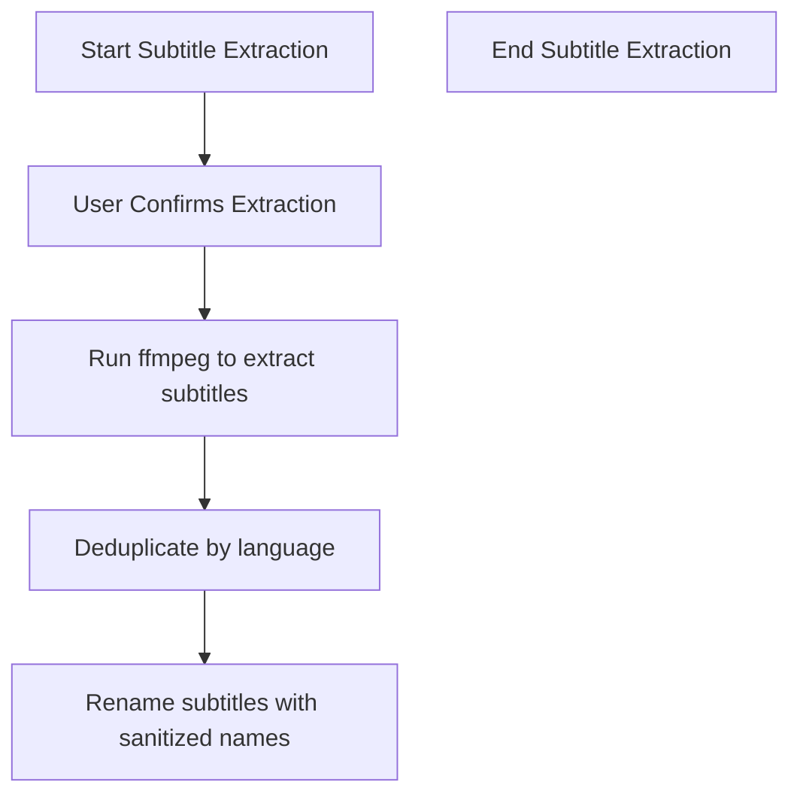
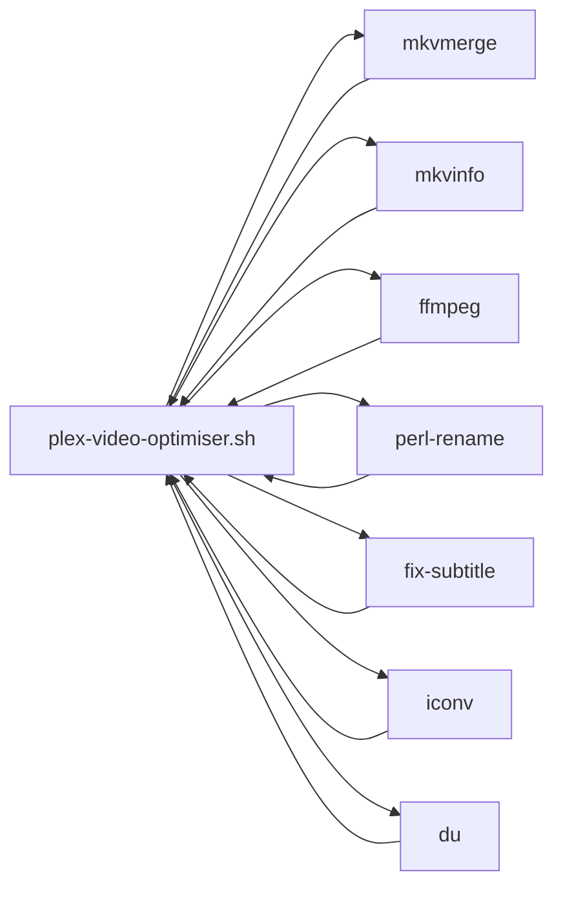

# plex-video-optimiser Architecture

## Overview

This document describes the current architecture of plex-video-optimiser, a single-file Bash script that implements a linear pipeline for video file optimisation. It details the system context, component responsibilities, data flow, external dependencies, and operational characteristics.

## 📑 Table of Contents

- [Purpose](#-purpose)
- [System Context](#-system-context)
- [Architectural Style](#-architectural-style)
- [Runtime Flow](#-runtime-flow)
- [Components](#-components)
- [Architectural Areas](#-architectural-areas)
- [Data Architecture](#-data-architecture)
- [Interfaces and Integrations](#-interfaces-and-integrations)
- [Key Flows](#-key-flows)
  - [Main Execution Flow](#-main-execution-flow)
  - [Subtitle Extraction Flow](#-subtitle-extraction-flow)
- [Domain-Specific Concerns](#-domain-specific-concerns)
- [Cross-Cutting Concerns](#-cross-cutting-concerns)
  - [Security and Privacy](#-security-and-privacy)
  - [Error Handling](#-error-handling)
  - [Observability](#-observability)
  - [Configuration](#-configuration)
- [Dependency Direction and Rules](#-dependency-direction-and-rules)
- [External Dependencies](#-external-dependencies)
- [Deployment and Operations](#-deployment-and-operations)
- [Compatibility Contracts](#-compatibility-contracts)
- [Testing and Verification](#-testing-and-verification)
- [Design Constraints](#-design-constraints)
- [Extension Points](#-extension-points)
- [Evolution and Migration](#-evolution-and-migration)
- [Architecture Decisions](#-architecture-decisions)
- [Source Map](#-source-map)
- [Related Documentation](#-related-documentation)

## 🎯 Purpose

This script provides a command-line tool for optimizing video files to ensure compatibility with Plex direct-stream playback. It converts video codecs (AV1/VP9 → H.264), manages audio tracks (selecting, converting, preserving), extracts and processes subtitles, sanitises filenames for Plex compatibility, and ensures the output file is in a compatible container format.

## 🌐 System Context

The system is a single-file Bash script (`scripts/plex-video-optimiser.sh`) executed locally on a user's machine. Input is a media file path provided as a command-line argument. External interactions are limited to local command-line tools: `mkvmerge`, `mkvinfo`, `ffmpeg`, `perl-rename`, `fix-subtitle`, `iconv`, and `du`. No network connectivity, telemetry, or external services are used. Trust boundary is the local execution environment; all data remains on the operator's filesystem.

## 🏗️ Architectural Style

Sequential script with linear pipeline; no modular decomposition into separate files. All logic resides in one script with function definitions at the top and main execution flow at the bottom. Consequence: simple ownership, easy modification but limited reusability.

## 🔄 Runtime Flow

```mermaid
flowchart TD
    InputFile[Input File] --> Validation[File Validation & Metadata Extraction]
    Validation --> TrackAnalysis[Track Analysis (Video, Audio, Subtitles)]
    TrackAnalysis --> Decision[Decision Engine (what needs conversion)]
    Decision --> FFmpegArgs[FFmpeg Argument Construction]
    FFmpegArgs --> Confirmation[User Confirmation]
    Confirmation --> Execution[Optimisation Execution (ffmpeg)]
    Execution --> SubtitleProc[Subtitle Extraction & Post-Processing (optional)]
    SubtitleProc --> Verification[Output Verification & Replacement Prompt]
    Verification --> Final[Final Output]
```

The principal runtime sequence is:
1. Input file provided as command-line argument
2. File validation and metadata extraction
3. Track analysis (video, audio, subtitles)
4. Decision engine determines required conversions
5. FFmpeg argument construction
6. First user confirmation
7. Optimisation execution (ffmpeg)
8. Optional subtitle extraction and post-processing
9. Second user confirmation for replacement
10. Final output written to disk

## 🧩 Components

| Component | Location | Responsibility |
|-----------|----------|----------------|
| File validation | Lines 1-10 | Verify input file exists and is accessible |
| Metadata extraction | Lines 11-30 | Parse filename, extension, directory, generate session ID |
| File naming | Lines 31-65 | Sanitise output filename, detect TV show episodes |
| Track analysis | Lines 67-200 | Query mkvmerge/mkvinfo for track formats, names, languages |
| Decision engine | Lines 202-210 | Determine which tracks need conversion or removal |
| Video processing | Lines 212-210 | Detect AV1/VP9, generate H.264 conversion arguments |
| Audio processing | Lines 212-270 | Select preferred audio tracks, convert to AAC, preserve originals |
| Subtitle processing | Lines 272-380 | Language detection, forced/SDH filtering, deduplication |
| FFmpeg orchestration | Lines 382-450 | Combine arguments, handle container conversion, execute |
| User interaction | Lines 452-520 | Confirmations, progress display, replacement prompt |

## 🗂️ Architectural Areas

### Core Processing Area

Paths:
- `scripts/plex-video-optimiser.sh`

Responsibilities:
- Execute the complete optimisation pipeline from input validation to final output
- Manage all internal state and decision logic

Boundary rules:
- All logic resides in a single file; no internal modules or separate scripts
- Uses external command-line tools for media processing
- No persistent state beyond temporary files and session ID

## 💾 Data Architecture

```mermaid
flowchart TD
    Input[Input File Path] --> Meta[Metadata (filename, extension, directory, session ID)]
    Meta --> Tracks[Track Metadata (format, name, language, count)]
    Tracks --> Decision[Decision Engine (optimisation flags)]
    Decision --> Args[FFmpeg Arguments]
    Args --> Output[Optimised Output File]
    Output --> Subtitles[Extracted Subtitle Files]
```

| Data or Store | Owner | Representation and Storage | Lifecycle or Consistency |
|---------------|-------|----------------------------|--------------------------|
| Input File Path | Script (global) | Command-line argument string | Exists for duration of run; immutable |
| Session ID | Script (global) | 32-character random string from `/dev/urandom` | Generated at start, used for temp file isolation, not persisted |
| Track Metadata | Script (global) | Parsed from mkvmerge/mkvinfo output; includes format, name, language, index | Exists during processing; discarded after decision |
| FFmpeg Arguments | Script (global) | Constructed string built incrementally | Exists until execution; discarded after run |
| Output File Path | Script (global) | Derived from sanitised filename, same directory as input | Created as temp file, then renamed after confirmation |
| Extracted Subtitle Files | Script (global) | `.srt` files in input directory | Created during subtitle flow, retained unless manually deleted |

Data Architecture:

The system owns the input file path and temporary output files. It transforms track metadata into conversion decisions, constructs ffmpeg arguments, and writes output files. Subtitle extraction produces additional files in the input directory. All data remains on the operator's local filesystem. No central storage or network transmission occurs.

## 🔌 Interfaces and Integrations

| Interface or Integration | Direction | Contract | Owner | Failure Semantics |
|--------------------------|-----------|----------|-------|-------------------|
| Command-line argument (file path) | Inbound | Path to a readable media file | Script | Invalid path causes early exit with error |
| stdout / stderr | Outbound | Textual progress, decisions, errors | Script | Propagated to user; script exits on fatal error |
| mkvmerge (mkvmerge -i) | Inbound | Media file content for track inspection | Script | Failure aborts processing; error propagated |
| mkvinfo | Inbound | Detailed track metadata | Script | Failure aborts processing; error propagated |
| ffmpeg | Inbound/Outbound | Media file input, encoded output | Script | Failure aborts processing; non-zero exit code |
| perl-rename | Inbound | Subtitle filenames for renaming | Script | Failure leaves subtitles with original names |
| fix-subtitle | Inbound | Subtitle content for post-processing | Script | Failure leaves subtitles unchanged |
| iconv | Inbound | Character encoding conversion for filenames | Script | Failure may cause transliteration errors |
| du | Inbound | File size for reporting | Script | Failure does not affect processing |

Key Flows:

## 🔀 Key Flows

### Main Execution Flow

```mermaid
flowchart TD
    Start([Start]) --> Validate[Validate Input]
    Validate --> Extract[Extract Metadata]
    Extract --> Analyze[Analyze Tracks]
    Analyze --> Decide[Decision Engine (what needs conversion)]
    Decide --> BuildArgs[Build FFmpeg Arguments]
    BuildArgs --> Confirm1[First Confirmation]
    BuildArgs --> Execute[Execute ffmpeg]
    Execute --> SubtitleProc[Subtitle Extraction & Post-Processing (optional)]
    Confirm2[Second Confirmation]
    Confirm2 --> Replace[Replace Original?]
    Confirm2 --> End[End]
```

### Subtitle Extraction Flow



Domain-Specific Concerns:

## ⚙️ Domain-Specific Concerns

### Filename Sanitisation

The script applies a 14-step sanitisation pipeline to output filenames, removing release groups, quality tags, codecs, and other metadata while preserving TV show episode identifiers (SxxExx pattern) and sanitising special characters for filesystem compatibility.

### Track Detection

Video track detection relies on mkvmerge output to identify container format and video codec; audio track detection similarly uses mkvmerge output. The decision engine uses these results to determine conversion needs.

### Audio Preference Order

Audio track handling follows a priority: preferred format (AAC/MP3) → first non-commentary track → preserve original tracks for movies; TV show episodes default to first compatible audio track unless `KEEP_ORIGINAL_AUDIO_TRACKS_FOR_TVSHOWS=true`.

Cross-Cutting Concerns:

## 🧵 Cross-Cutting Concerns

### Security and Privacy

The script operates entirely offline with no network access, telemetry, or external data transmission. All data remains on the operator's local filesystem. The instance operator has full control over storage, logs, and deletion. No personal data beyond the media file content is processed.

### Error Handling

Failures in external tools (mkvmerge, mkvinfo, ffmpeg) cause the script to exit with a non-zero status, propagating the error to the user. No internal exception handling is implemented; the script terminates on any uncaught error.

### Observability

The script outputs progress information, file sizes, and track listings to stdout. No structured logging or metrics are emitted; diagnostics rely on console output and manual inspection.

### Configuration

Configuration is handled via hardcoded environment variables (`KEEP_ORIGINAL_AUDIO_TRACKS_FOR_TVSHOWS`, `KEEP_FORCED_SUBTITLES`, `KEEP_SDH_SUBTITLES`) with default values. Operators may edit the script to modify constants.

### Concurrency and Resource Use

The script is single-threaded and synchronous with no background jobs or parallelism. Resource usage is limited to CPU during ffmpeg execution and disk space for temporary files.

## 🧭 Dependency Direction and Rules



The script has no internal modules; all dependencies are external command-line tools invoked as subprocesses. Permitted dependency direction is from the script to external tools. Prohibited: internal module creation, dynamic code loading.

## 📦 External Dependencies

| Dependency | Responsibility | Integration Boundary | Architectural Consequence |
|------------|----------------|----------------------|---------------------------|
| mkvmerge (mkvtoolnix) | Container inspection and track metadata extraction | Called as subprocess with `-i` argument | Provides reliable track metadata; version changes may affect parsing |
| mkvinfo (mkvtoolnix) | Detailed track metadata extraction | Subprocess call | Complements mkvmerge; used for language detection |
| ffmpeg | Video/audio transcoding and container remuxing | Subprocess with input and output arguments | Core conversion engine; supports many codecs |
| perl-rename | Batch rename of extracted subtitle files | Batch rename executed on subtitle files | Enables filename normalisation; depends on Perl |
| fix-subtitle | Subtitle post-processing | Subprocess called on subtitle files | Improves subtitle timing and format compatibility |
| iconv | Character encoding transliteration for filenames | Subprocess used during filename sanitisation | Ensures cross-platform filename compatibility |
| du | File size reporting for progress display | Subprocess called on input and output files | Provides size information for user feedback |

## 🚀 Deployment and Operations

| Concern | Current Design | Architectural Consequence |
|---------|----------------|---------------------------|
| Process topology | Single process executing the script | No scaling or distribution; runs on a single machine |
| Deployment model | Self-hosted, no installation beyond dependencies | Operator must have mkvtoolnix, ffmpeg, perl-rename, fix-subtitle, iconv installed |
| Persistent state | None beyond input file and temporary files | No database or cache; state is ephemeral |
| Scaling assumptions | None; designed for single-file processing | Not suitable for batch processing of many files without wrapper scripts |
| Startup | Script execution via `./plex-video-optimiser.sh <file>` | Immediate start; requires user confirmation before processing |
| Shutdown | Exit after processing completes or on error | Clean termination; temporary files may remain if user declines replacement |

## 🛡️ Compatibility Contracts

| Contract | Owner | Invariant | Verification | Change Policy |
|----------|-------|-----------|--------------|---------------|
| Input file format | Script | Accepts any container supported by mkvmerge (e.g., MKV, MP4, AVI) | Runtime validation via file existence and mkvmerge inspection | New container support requires updating mkvmerge invocation |
| Output file format | Script | Produces MKV container with H.264 video and AAC/MP3 audio | Verified by mkvmerge inspection of output | Changing output format requires script modification |
| Command-line interface | Script | Accepts exactly one positional argument (input file path) | Argument parsing logic | Adding more arguments requires interface change |

## ✅ Testing and Verification

Manual testing only; no automated tests exist. Verification is performed by executing the script on sample media files and inspecting output files and console output. Recommended test scenarios include:

- Optimising an AV1 file to H.264
- Processing a file with multiple audio tracks
- Extracting and deduplicating subtitles
- Running the script on an already-optimised file (should report "No optimisation needed")

## 🛑 Design Constraints

- Single-file limitation prevents modular testing and independent component deployment
- Reliance on external tool versions (mkvtoolnix, ffmpeg) means behaviour may vary across environments
- No parallelism; processing is sequential and may be slow for large files
- Interactive confirmations required, preventing fully automated batch processing without wrapper scripts

## 🔌 Extension Points

- Substitute ffmpeg with an alternative transcoding tool while maintaining argument structure
- Add new processing steps (e.g., watermarking) by extending the decision engine and FFmpeg argument construction
- Replace perl-rename with an alternative filename manipulation tool
- Integrate additional subtitle processing libraries if needed

## 🔄 Evolution and Migration

Not applicable; the script is stable with no planned architectural changes.

## 📌 Architecture Decisions

- Use `mkvmerge` and `mkvinfo` for track inspection
- Use `ffmpeg` for transcoding
- Use `perl-rename` for subtitle renaming
- Generate a unique session ID from `/dev/urandom` for temp file isolation
- Implement two-stage user confirmation to ensure intentional replacement of original files

## 🗺️ Source Map

The architecture is documented in a single script located at `scripts/plex-video-optimiser.sh`. No additional directories or modules exist.

## 📚 Related Documentation

- `README.md` – project overview and usage instructions
- `PRIVACY.md` – data handling and privacy policy
- `ARCHITECTURE.md` – this document